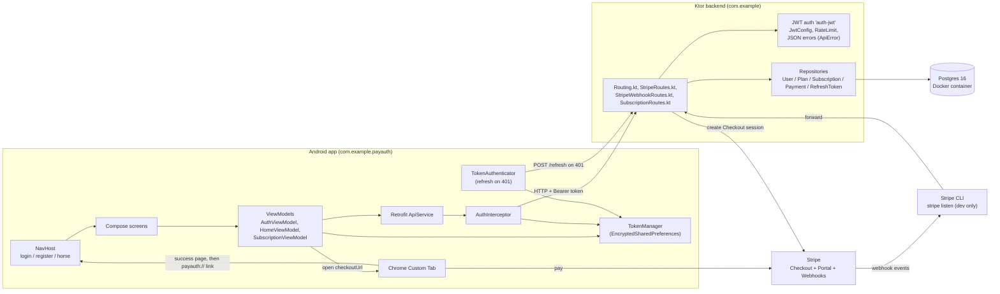
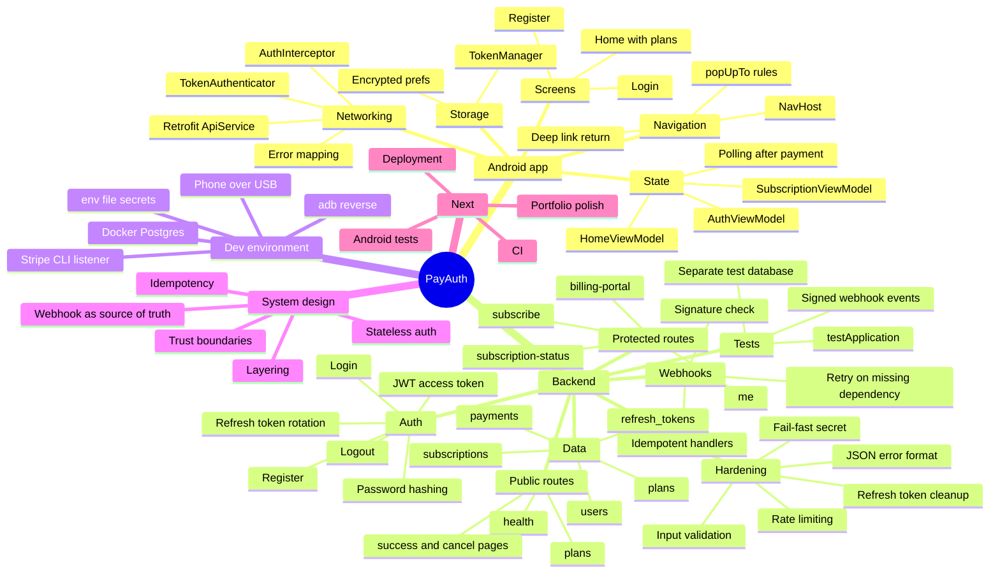
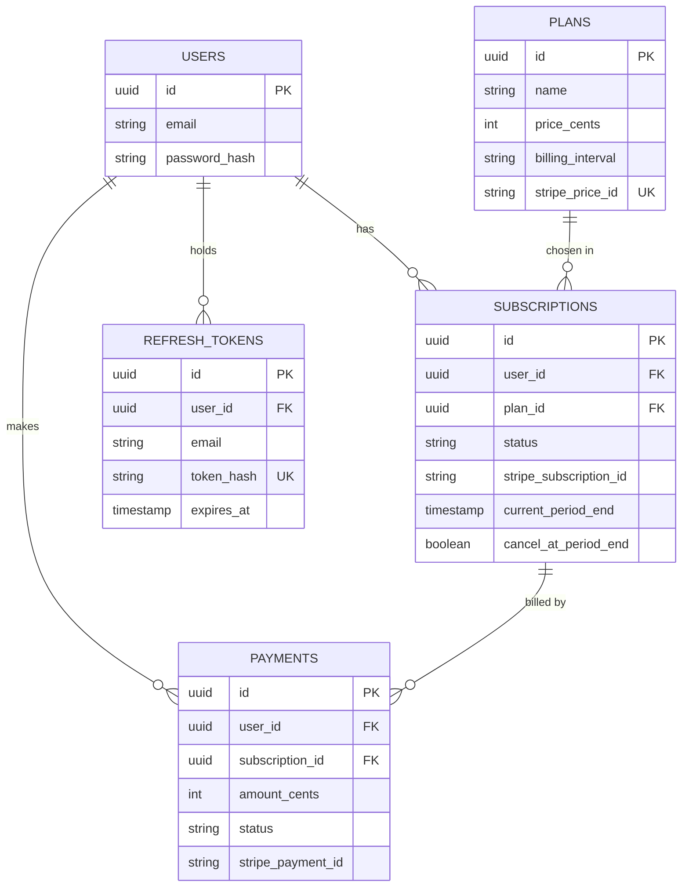
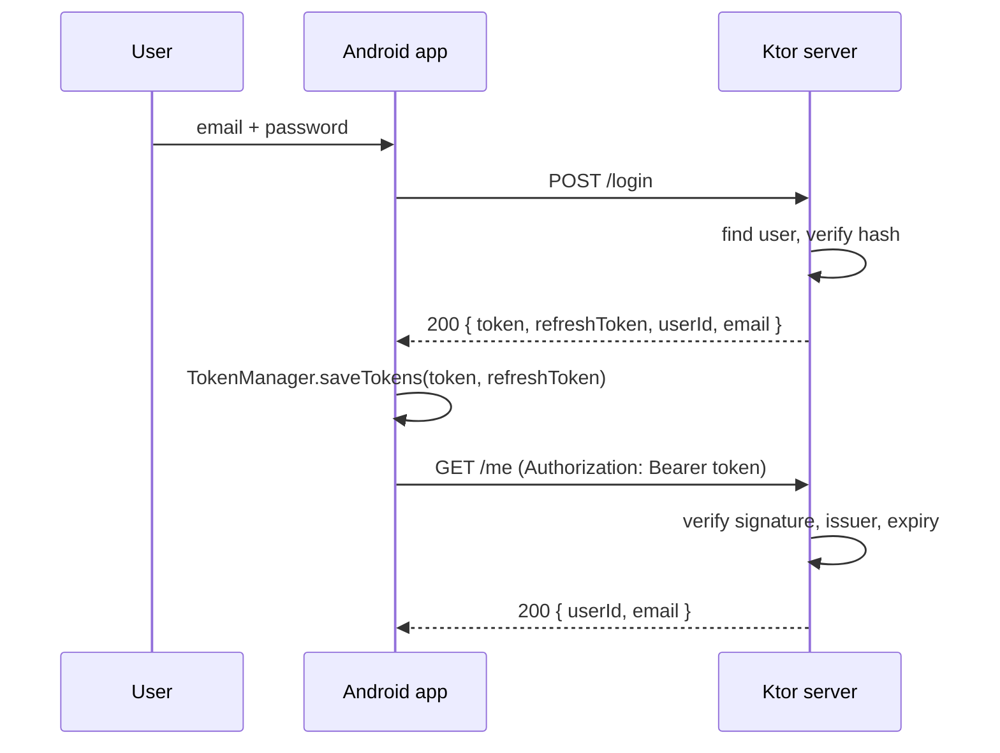
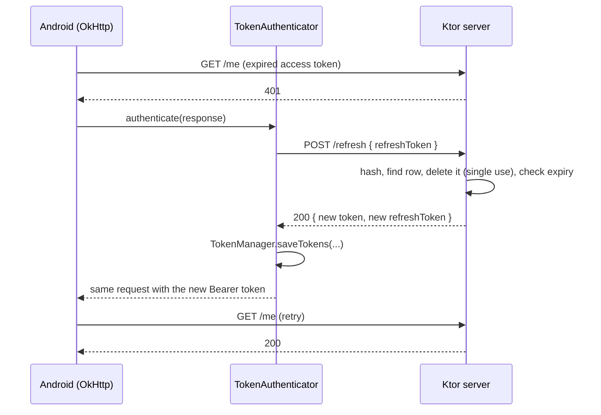
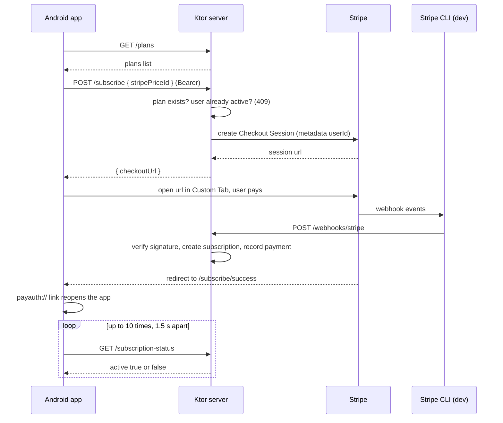
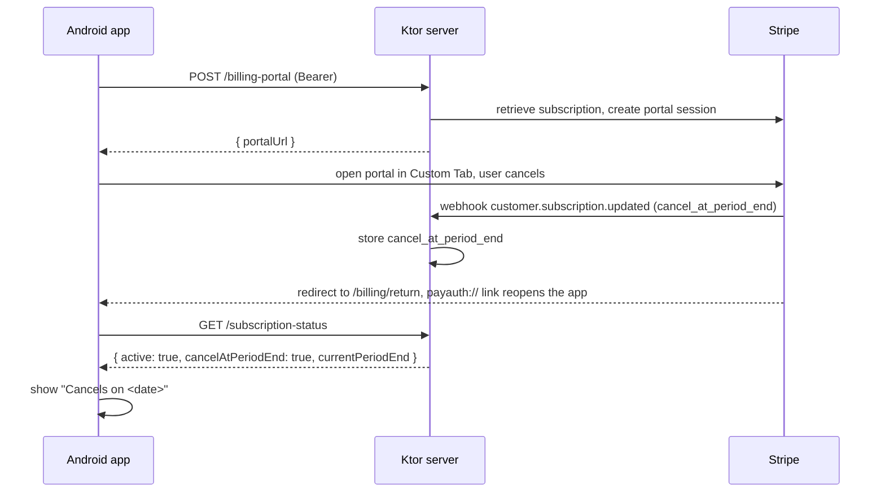
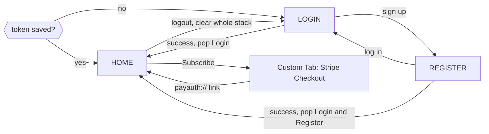

# PayAuth: Android + Ktor SaaS Starter

A learning project: an Android app with real authentication and subscription payments
(Stripe Checkout), backed by a Ktor server and Postgres. This README is both the
documentation and the study guide: what exists, how it fits together, the schemas, the
system design idea behind each step, and what is left.

> **Accuracy note.** Sections marked **(verified)** come from code or terminal output
> that was actually reviewed. Sections marked **(derived)** are reconstructed from
> repository code, so confirm them with `\d <table>` in psql. Anything marked
> **(proposed)** is a design that does not exist yet.

---

## 1. Status snapshot

| Area | State |
|---|---|
| Register / login (JWT) | Done |
| Encrypted token storage, auto-login, logout | Done |
| Protected route `/me` | Done |
| Plans list from the database (`GET /plans`) | Done |
| Stripe Checkout via `POST /subscribe` (opens in a Custom Tab) | Done |
| Double-subscription guard (409 if already active) | Done |
| Webhooks: signature check, subscription and payment rows | Done |
| Return to the app after paying (`payauth://` deep link) | Done |
| App waits for the webhook before showing the plan | Done |
| Navigation Compose with a proper back stack | Done |
| Local dev on Windows (Docker Postgres, phone over USB) | Done |
| Customer Portal ("Manage subscription"), cancel at period end stored and shown | Done |
| Session expiry: 15 min access token + rotating refresh token, `/refresh`, `/logout` | Done |
| Plan switching in the portal (webhook updates `plan_id`) | Done |
| Backend tests: auth, refresh rotation, webhooks, rate limit (separate `saas_test` DB) | Done |
| Hardening: fail-fast JWT secret, rate limiting, input validation, JSON error format, refresh-token cleanup, debug-only cleartext HTTP | Done |
| CI, Android tests, deployment, HTTPS release config | Not started |

---

## 2. Architecture at a glance



**Stack:** Kotlin, Jetpack Compose, Navigation Compose, Hilt, Retrofit/OkHttp, Coroutines +
StateFlow on the app. Ktor, Exposed, java-jwt, stripe-java, Postgres on the server.

**Ports:** `8080` is the Ktor backend, `5432` is Postgres. They are different services, so
there is no conflict.

---

## 3. Mind map



---

## 4. Local development setup (Windows)

### 4.1 Daily start-up checklist

1. `docker compose up -d`, then `docker compose ps`. `saas_postgres` should be healthy.
2. Run the backend from IntelliJ. Wait for the `Responding at http://0.0.0.0:8080` line.
3. `stripe listen --forward-to localhost:8080/webhooks/stripe` in its own terminal.
   Leave it open while testing payments.
4. Phone connected over USB with debugging on, then run `adb reverse tcp:8080 tcp:8080`.
5. Run the app from Android Studio, with the app's base URL set to `http://localhost:8080/`.

### 4.2 Files and settings that must exist

| Item | Notes |
|---|---|
| `docker-compose.yml` | Postgres only. Ktor settings do **not** belong here. |
| `src/main/resources/application.yaml` | Holds the `ktor:` block (port 8080, modules). Easy to lose when moving machines. |
| `.env` (backend folder) | `JWT_SECRET`, the Stripe secret key, `STRIPE_WEBHOOK_SECRET`, optional `PUBLIC_BASE_URL`, optional `ACCESS_TOKEN_MINUTES` (default 15). `JWT_SECRET` is required: the server refuses to start without it. Tests do not use `.env`; Gradle injects test values. Never commit it. If you run from IntelliJ, the Run configuration's environment variables win over the file. |
| Database credentials | `saas_db` / `saas_user` / `saas_password` on `localhost:5432` (from the compose file). |

### 4.3 Seed the database (it starts empty on a new machine)

```powershell
docker exec -it saas_postgres psql -U saas_user -d saas_db -c "INSERT INTO plans (id, name, price_cents, billing_interval, stripe_price_id) VALUES (gen_random_uuid(), 'Pro', 999, 'month', 'price_YOUR_REAL_ID');"
```

The price id must come from the **same Stripe account** as the API key in `.env`.

### 4.4 Stripe: three things must point at the same account

1. The secret key in `.env`.
2. The account the Stripe CLI is logged into (`stripe login`, or `--api-key`).
3. The webhook signing secret (`whsec_...`) printed by `stripe listen`.

If any one of them belongs to another account, the symptoms are "No such price", a silent
listener, or `400 Invalid signature` on every event.

### 4.5 PowerShell test commands (verified)

```powershell
# health
Invoke-RestMethod http://localhost:8080/health

# register (first time), then log in and keep the token
Invoke-RestMethod -Method Post http://localhost:8080/register -ContentType "application/json" -Body '{"email":"test@example.com","password":"password123"}'
$login = Invoke-RestMethod -Method Post http://localhost:8080/login -ContentType "application/json" -Body '{"email":"test@example.com","password":"password123"}'
$token = $login.token
$headers = @{ Authorization = "Bearer $token" }

# protected routes
Invoke-RestMethod http://localhost:8080/me -Headers $headers
Invoke-RestMethod http://localhost:8080/plans
Invoke-RestMethod http://localhost:8080/subscription-status -Headers $headers

# start checkout, copy the whole URL, open it
$r = Invoke-RestMethod -Method Post http://localhost:8080/subscribe -Headers $headers -ContentType "application/json" -Body '{"stripePriceId":"price_YOUR_REAL_ID"}'
$r.checkoutUrl | Set-Clipboard
Start-Process $r.checkoutUrl
```

Use `curl.exe` (with the `.exe`) if you prefer curl, because plain `curl` in PowerShell is an
alias for a different command. Access tokens last 15 minutes by default (`ACCESS_TOKEN_MINUTES`), so
rerun the login block or use `/refresh` when calls return 401. Variables only exist in the window where you set them.

Refresh-token test (verified):

```powershell
$body = @{ refreshToken = $login.refreshToken } | ConvertTo-Json
$new = Invoke-RestMethod -Method Post http://localhost:8080/refresh -ContentType "application/json" -Body $body
# the same $body again must now return 401 (token already used)
Invoke-RestMethod -Method Post http://localhost:8080/logout -ContentType "application/json" -Body (@{ refreshToken = $new.refreshToken } | ConvertTo-Json)
```

Set `ACCESS_TOKEN_MINUTES=1` in `.env` to watch a refresh happen quickly, then remove it.

### 4.6 Database inspection

```powershell
docker exec -it saas_postgres psql -U saas_user -d saas_db -c "\dt"
docker exec -it saas_postgres psql -U saas_user -d saas_db -c "SELECT * FROM plans;"
docker exec -it saas_postgres psql -U saas_user -d saas_db -c "SELECT user_id, status, cancel_at_period_end FROM subscriptions;"
docker exec -it saas_postgres psql -U saas_user -d saas_db -c "SELECT id, email, expires_at FROM refresh_tokens;"
```

### 4.7 Troubleshooting table (every one of these happened)

| Symptom | Cause | Fix |
|---|---|---|
| Compose says `additional properties 'ktor' not allowed` | Ktor config pasted into the compose file | Move it to `application.yaml` |
| App cannot reach the server on an emulator or phone | Port not forwarded | `adb reverse tcp:8080 tcp:8080` (lost on restart) |
| PowerShell call prints nothing | Server not running | Check `/health` first |
| "Token is missing" | `$headers` empty in a new window, or no user in a fresh database | Log in again in the same window |
| `Unknown plan` (400) from `/subscribe` | Price id not in the `plans` table | Insert or fix the row |
| `No such price` (Stripe error) | Key and price in different accounts | Create the price in the key's account |
| Listener shows `-->` lines but no `<--` | Started without `--forward-to` | Restart with the flag |
| Every webhook returns 400 | Signing secret does not match this listener | `stripe listen --print-secret`, update `.env`, restart backend |
| Checkout link says "incomplete" | URL truncated when copied | `Set-Clipboard` or `Start-Process` |
| Tapping the return link does nothing | No `payauth://` intent filter in the manifest | Add the filter and reinstall the app |
| Home still shows Subscribe right after paying | Webhook not processed yet | App polls the status for about 15 seconds |
| Portal call fails with "pass either subscription_data or line_items or mode" | Checkout `SessionCreateParams` used instead of the `billingportal` classes | Use `com.stripe.param.billingportal.SessionCreateParams` and `com.stripe.model.billingportal.Session` |
| New DB column (`cancel_at_period_end`) missing at runtime | `SchemaUtils.create` never alters existing tables | `ALTER TABLE ... ADD COLUMN ...` by hand |
| Logged out after about 15 minutes | Access token expired and no refresh token saved (old session) | Log in again once; the authenticator refreshes from then on |
| Portal has no "Update plan" button | "Customers can switch plans" is off, or the products are not listed, in the portal settings | Settings, Billing, Customer portal, Subscriptions: enable it, add both products, save, reopen the portal |
| Plan switched in Stripe but not in the app | Backend still running old code, or the price id is missing from `plans` | Restart the backend; check the server log for `no plan found for price` |
| Every test fails, first failure is `ConnectException` / `PoolInitializationException` | Docker Postgres is not running | `docker compose up -d`, check `docker compose ps`; read the **first** failure, the rest are fallout |
| Every test fails with `IllegalStateException` from `RateLimitInterceptors` | Test app builds routes without installing the rate-limit plugin | Add `configureRateLimit()` before `configureRouting()` in `appTest` |
| `gradlew test` says `UP-TO-DATE` | Gradle skipped the run, nothing changed | `.\gradlew cleanTest test` |
| Server stops at startup: missing `JWT_SECRET` | Fail-fast guard working | Set it in `.env` |
| Emulator unresponsive next to the server | 16 GB RAM pressure | Test on a physical phone, cap WSL memory in `.wslconfig` |

### 4.8 Running the backend tests

One-time: create the test database (same Docker Postgres, separate database):

```powershell
docker exec -it saas_postgres psql -U saas_user -d saas_db -c "CREATE DATABASE saas_test;"
```

Run (Postgres must be up):

```powershell
.\gradlew cleanTest test --console=plain
Get-ChildItem build\test-results\test\*.xml | Select-String 'tests='
```

How it works:
- `build.gradle.kts` injects `DB_URL` (`saas_test`), `JWT_SECRET`, a dummy `STRIPE_SECRET_KEY` and `STRIPE_WEBHOOK_SECRET` into the test JVM. `Env.get` reads real environment variables before `.env`, so dev data is never touched.
- `TestDb.reset()` empties every table before each test and refuses to run unless `DB_URL` ends in `saas_test`.
- `appTest { }` boots the real modules (security, serialization, rate limit, routing) with `testApplication`.
- Webhook tests build Stripe-shaped event JSON and sign it with HMAC-SHA256 (`t=<ts>,v1=<sig>`), exactly like Stripe, using the test secret.
- `DatabaseFactory.init()` is guarded so it only runs once per JVM (otherwise every test would open a new connection pool).

---

## 5. Roadmap

Legend: Done, Next, Later.

### Phase 0: Foundations (Done)
Ktor project, `GET /` and `GET /health`, database connection through `DatabaseFactory.init()`,
Android project with Hilt and Retrofit, health check to prove the app reaches the server.
**Design idea:** a health endpoint separates "network problem" from "logic problem".

### Phase 1: Auth backend (Done)
- `POST /register`: email and password (8+ characters) validation, duplicate check (409),
  hashed password, token returned with 201.
- `POST /login`: lookup, hash verification, token with 200, or 401 with a deliberately
  vague message.
- `JwtConfig`: HMAC256, issuer `ktorbackend`, claims `userId` and `email`. Expiry started at
  1 hour and is now 15 minutes (see Phase 8).
  **Design ideas:** never store plain passwords; never reveal which half of the credentials
  was wrong; secrets live in environment variables.

### Phase 2: Android auth screens (Done)
`AuthViewModel` with `login()`, `register()`, `resetState()` and a sealed `AuthUiState`
(`Idle`, `Loading`, `Success`, `Error`); `LoginScreen` and `RegisterScreen` with HTTP errors
mapped to readable messages (409 duplicate, 400 invalid input, 401 bad credentials).
**Design idea:** one sealed state class makes impossible UI states impossible.

### Phase 3: Session persistence (Done)
`TokenManager` (EncryptedSharedPreferences), `AuthInterceptor` adding the Bearer header to
every request, one `OkHttpClient` shared through Hilt, auto-login, logout.
**Design ideas:** cross-cutting concerns belong in one interceptor; the token lives in
exactly one place.

### Phase 4: Protected route (Done)
`GET /me` inside `authenticate("auth-jwt")`, `HomeViewModel.load()`, 401 sends the user
back to Login.
**Design idea:** the server trusts only the verified token, never an id sent by the client.

### Phase 5: Plans and Checkout (Done)
- `GET /plans` (public): lists plans from the database.
- `POST /subscribe` (authenticated): checks the plan exists, **refuses with 409 if the
  user already has an active or trialing subscription**, creates a Stripe Checkout Session
  with `userId` in metadata, returns `checkoutUrl`.
- Android: Home lists plans as buttons, the chosen `stripePriceId` goes to `/subscribe`,
  the URL opens in a Chrome Custom Tab. No price id is hardcoded in the app any more.

### Phase 6: Webhooks and subscription state (Done)
- `POST /webhooks/stripe`: signature verified on the raw body, then:
  `checkout.session.completed` creates the subscription row,
  `customer.subscription.updated` and `.deleted` update status and period end,
  `invoice.payment_succeeded` records a payment. Every other event is acknowledged with 200.
- Handlers are idempotent (they check for an existing row first) and return 409 when a
  dependency has not landed yet, so Stripe retries.
- `GET /subscription-status` (authenticated): `active`, `status`, `planName`,
  `currentPeriodEnd`.
- Return flow: Stripe redirects to `/subscribe/success`, a page on the backend that hands
  the browser a `payauth://subscribe/success` link; the manifest filter opens the app; Home
  polls `/subscription-status` (every 1.5 s, up to 10 times) until it turns active.

### Phase 7: Navigation Compose (Done)
`NavHost` with `login`, `register`, `home`. Start destination chosen from the stored token.
After login or register the auth screens are popped; after logout the whole stack is
cleared. Each destination gets its own ViewModel instance, which removed the shared-state
problem the `Screen` enum had.

### Phase 8: Hardening (Done, with a short list left)
**Session expiry with refresh tokens**
- Access token (JWT) lives 15 minutes (`ACCESS_TOKEN_MINUTES`). `/login` and `/register`
  also return a random 32-byte **refresh token** valid for 30 days.
- Only the SHA-256 hash of a refresh token is stored (`refresh_tokens` table). A plain hash
  is enough because the token is random, so it cannot be guessed like a password.
- `POST /refresh` **rotates**: the presented token is deleted and a new pair is issued.
  Deletion is the "use it up" step; if it removes nothing, someone already used the token
  and the request gets 401.
- `POST /logout` deletes the refresh token on the server, so logout really ends the session.
- Android: `TokenAuthenticator` (OkHttp `Authenticator`) catches a 401, calls `/refresh` with
  a bare client, saves both tokens and retries the original request. It is `synchronized`
  so parallel 401s (Home loads `/me` and `/subscription-status` together) refresh once.
  If the refresh token is rejected, tokens are cleared and the user ends up at Login.
- A background job (`configureCleanup`) deletes expired rows from `refresh_tokens` every 6 hours.

**Other hardening**
- **Fail fast:** `JwtConfig` uses `Env.require("JWT_SECRET")`, no insecure fallback.
- **Rate limiting** (Ktor `RateLimit`, per client IP): login and register share 10 per minute,
  refresh 30 per minute. Over the limit: `429` with a `Retry-After` header.
- **Input validation on `/register`:** email format and at most 254 characters, password 8 to 72
  bytes (BCrypt ignores anything past 72 bytes, so longer passwords are rejected, not truncated),
  email trimmed before use.
- **Consistent JSON errors:** `{ "error": "...", "code": "EMAIL_TAKEN" }` for auth and
  `/me` failures, so clients switch on the code, not on free text.
- **Webhook route:** a missing `Stripe-Signature` header now returns 400 (a test caught that it
  used to crash with 500), and the reason for a failed signature is logged.
- **Android:** cleartext HTTP is allowed only in the debug variant
  (`app/src/debug/AndroidManifest.xml`); release builds require HTTPS.

**Design ideas:** short-lived credentials limit the damage of a leak; rotation makes a stolen
refresh token useless after the real app uses it; rate limits make guessing expensive; validate
at the boundary; stable error codes decouple the API from UI wording.

**Still to do:**
- A friendly "too many attempts" message for 429 in `AuthViewModel`.
- Convert `StripeRoutes` and `SubscriptionRoutes` errors to the JSON format.
- Case-insensitive email handling (normalize to lowercase; needs a data migration for existing users).
- Behind a reverse proxy every request looks like it comes from the proxy: install forwarded-headers
  handling before relying on per-IP limits in production.
- Request body size limits; reuse detection (revoke all of a user's tokens if a used refresh token is replayed).
- A per-build-type `BASE_URL` in the Android app (debug `http://localhost:8080/`, release HTTPS).

### Phase 9: Plan changes and cancellation (mostly done)
- **Done:** `POST /billing-portal` creates a Stripe Customer Portal session; the app opens it
  from "Manage subscription" and the portal return page (`/billing/return`) deep-links back.
- **Done:** `customer.subscription.updated` stores `cancel_at_period_end` (true when Stripe
  reports `cancel_at_period_end` or a `cancel_at` date). `/subscription-status` returns
  `cancelAtPeriodEnd` and the app shows "Cancels on <date>".
- **Done:** switching plans in the portal. `handleSubscriptionUpdated` reads the price on the
  subscription, looks the plan up by `stripe_price_id` and updates `plan_id` (an unknown price
  syncs status but leaves the plan alone and logs it). Needs "Customers can switch plans"
  enabled in the Stripe portal settings, with both products listed.
- **To decide:** whether `trialing` counts as active. `/subscribe` blocks it but
  `/subscription-status` only counts exactly `active`.

### Phase 10: Testing (backend done)
- **Setup:** `src/test/kotlin/com/example/` with `TestSupport.kt`, `AuthTest.kt`, `WebhookTest.kt`
  (plus the template `ServerTest.kt`). The Gradle `test` task injects `DB_URL` (database
  `saas_test`), a test `JWT_SECRET` and fake Stripe keys as environment variables, which `Env.get`
  prefers over `.env`, so tests can never touch dev data or the real Stripe account.
  `TestDb.reset()` refuses to wipe any database whose URL does not end in `saas_test`.
  `DatabaseFactory.init()` is guarded to run once (and to retry after a failed start) so repeated
  app starts do not leak connection pools.
- **AuthTest:** register (201, duplicate 409 with `EMAIL_TAKEN`, short or over-long password and bad
  email 400), login (success, same 401 `INVALID_CREDENTIALS` for wrong password and unknown email),
  `/me` with and without a token, refresh rotation (a used token returns 401), unknown refresh token,
  logout revokes, login rate limit (11th attempt returns 429), expired refresh tokens are purged.
- **WebhookTest (7):** missing or wrong signature (400), unhandled event type (200), plan switch
  updates `plan_id`, cancel flag stored with the plan unchanged, unknown price keeps the plan,
  payment recorded once and a replay does not duplicate it, invoice before its subscription
  returns 409. Events are signed with the same HMAC scheme Stripe uses.
- **Not covered:** `checkout.session.completed` (it calls the Stripe API; the call would need to sit
  behind an interface so a test can fake it), `/subscribe`, `/billing-portal`, `/subscription-status`.
- **Run:** `.\gradlew cleanTest test --console=plain` with Docker Postgres up and `saas_test`
  created. A plain `gradlew test` can print `up-to-date` without running anything.
- **Still to do:** Android ViewModel tests with a fake `ApiService`, one UI test for login, CI that
  runs the tests against a Postgres service on every push.

### Phase 11: Deployment and operations (Later)
Dockerfile for the backend, managed Postgres, environment configuration, a real public HTTPS
`PUBLIC_BASE_URL`, a dashboard webhook endpoint in Stripe with its own signing secret,
structured logging, uptime check on `/health`, switch to live Stripe keys only at the very
end, release build and signing for the app.

### Phase 12: Portfolio polish (Later)
Screenshots or a short screen recording, setup instructions, and the "decisions and
trade-offs" table from section 9.

### Smaller improvements to schedule
- A `currency` column on `plans`, so the app can show a symbol (it shows `9.99 / month`).
- Show an explicit error or empty state when plans fail to load.
- A cancel-return screen for `payauth://subscribe/cancel`.

---

## 6. API contracts

### 6.1 Endpoints (verified)

| Endpoint | Auth | Request | Success | Errors |
|---|---|---|---|---|
| `GET /health` | no | none | `200 "OK"` | none |
| `POST /register` | no | `{ email, password }` | `201 { token, refreshToken, userId, email }` | `400` `INVALID_EMAIL` / `INVALID_PASSWORD` (8 to 72 chars), `409` `EMAIL_TAKEN`, `429` |
| `POST /login` | no | `{ email, password }` | `200 { token, refreshToken, userId, email }` | `401` `INVALID_CREDENTIALS`, `429` |
| `POST /refresh` | no | `{ refreshToken }` | `200 { token, refreshToken, userId, email }` (old refresh token is consumed) | `401` `INVALID_REFRESH_TOKEN` (invalid, expired or already used), `429` |
| `POST /logout` | no | `{ refreshToken }` | `204` (always) | none |
| `GET /me` | Bearer | none | `200 { userId, email }` | `401` |
| `GET /plans` | no | none | `200 [ { id, name, priceCents, billingInterval, stripePriceId } ]` | none |
| `POST /subscribe` | Bearer | `{ stripePriceId }` | `200 { checkoutUrl }` | `400` unknown plan, `409` already subscribed, `401`, `500` Stripe error |
| `GET /subscription-status` | Bearer | none | `200 { active, status?, planName?, currentPeriodEnd?, cancelAtPeriodEnd }` | `401` |
| `POST /billing-portal` | Bearer | none | `200 { portalUrl }` | `401`, `404` no subscription, `500` Stripe error |
| `GET /subscribe/success`, `/subscribe/cancel`, `/billing/return` | no | none | HTML page that opens the `payauth://` link | none |
| `POST /webhooks/stripe` | Stripe signature | raw event JSON | `200` | `400` missing or invalid signature, `409` dependency not ready (Stripe retries) |

JWT payload (from `JwtConfig`):

```json
{ "iss": "ktorbackend", "userId": "<uuid>", "email": "user@example.com", "exp": <issued + 15 min> }
```

### 6.2 Webhook events

| Event | Action |
|---|---|
| `checkout.session.completed` | Read `userId` from metadata, look up the plan by the price id, create the subscription row if it does not exist |
| `customer.subscription.updated` / `.deleted` | Update status, current period end, `cancel_at_period_end` (and `plan_id` from the price on the subscription) |
| `invoice.payment_succeeded` | Find the subscription (retries a few times), record one payment per invoice id |
| anything else | Acknowledged with 200, ignored |

Stripe also sends `v1.`-prefixed duplicates of events in its newer format. They are not
handled and not needed here.

### 6.3 Error format and rate limits

Auth and `/me` errors are JSON:

```json
{ "error": "Email already registered", "code": "EMAIL_TAKEN" }
```

| Code | Status | Meaning |
|---|---|---|
| `INVALID_EMAIL` | 400 | Not a valid email or longer than 254 characters |
| `INVALID_PASSWORD` | 400 | Shorter than 8 characters or longer than 72 bytes |
| `EMAIL_TAKEN` | 409 | Email already registered |
| `INVALID_CREDENTIALS` | 401 | Wrong email or password (same answer for both) |
| `INVALID_REFRESH_TOKEN` | 401 | Unknown, expired or already used |
| `UNAUTHORIZED` | 401 | Missing, invalid or expired access token |

Rate limits (per client IP): `/login` and `/register` share 10 requests per minute, `/refresh` has
30 per minute. Exceeding returns `429 Too Many Requests` with `Retry-After`. The Stripe routes
(`/subscribe`, `/billing-portal`) still return plain-text errors for now.

---

## 7. Database schemas

### 7.1 `plans` (verified from `\d plans`)

| Column | Type | Notes |
|---|---|---|
| id | uuid, PK | |
| name | varchar(100) | shown in the app |
| price_cents | integer | integer money, no floats |
| billing_interval | varchar(20) | for example `month` |
| stripe_price_id | varchar(255), unique | links to Stripe |

Referenced by `subscriptions.plan_id` with `ON DELETE RESTRICT`, so a plan with subscriptions
cannot be deleted. There is no `currency` or `active` column yet.

### 7.2 `subscriptions` (derived from `SubscriptionRepository`)

| Column | Type | Notes |
|---|---|---|
| id | uuid, PK | |
| user_id | uuid, FK to users | |
| plan_id | uuid, FK to plans | |
| status | varchar | Stripe's status: active, past_due, canceled, ... |
| stripe_subscription_id | varchar | used by webhooks to find the row |
| current_period_end | timestamp | latest row per user is the one the app trusts |
| cancel_at_period_end | boolean, NOT NULL, default false | set by the webhook; added by hand with `ALTER TABLE` |

### 7.3 `payments` (derived from `PaymentRepository` calls)

| Column | Type | Notes |
|---|---|---|
| id | uuid, PK | |
| user_id | uuid, FK | |
| subscription_id | uuid, FK | |
| amount_cents | int | |
| status | varchar | `succeeded` |
| stripe_payment_id | varchar | holds the **invoice id**, used for idempotency |

### 7.4 `refresh_tokens` (created by `SchemaUtils.create`)

| Column | Type | Notes |
|---|---|---|
| id | uuid, PK | |
| user_id | uuid, FK to users | |
| email | varchar(255) | copied in so `/refresh` can issue a JWT without a user lookup |
| token_hash | varchar(64), unique | SHA-256 hex of the raw token; the raw token is never stored |
| expires_at | timestamp | 30 days after issue |

### 7.5 `users` (partly verified)

`id` (uuid), `email`, and a password hash. The hash is never returned to clients.



### 7.6 Client-side state (verified)

```kotlin
sealed class AuthUiState { Idle, Loading, Success, Error(message) }
data class HomeState(email, isLoading, error, sessionExpired)
data class SubscriptionUiState(isLoading, confirming, active, planName, status,
                               checkoutUrl, error, plans, cancelAtPeriodEnd, currentPeriodEnd)
```

---

## 8. Key flows

### 8.1 Login and authenticated request



### 8.1b Silent refresh when the access token expires



If `/refresh` answers 401 the tokens are cleared and the user has to log in again.

### 8.2 Subscription purchase (as built)



### 8.3 Manage subscription and cancel



### 8.4 Navigation graph



---

## 9. System design lessons (each one mapped to this code)

| Concept | Where it shows up | Why it matters |
|---|---|---|
| Stateless authentication | JWT verified on every request, no server session | Scales horizontally; trade-off is that a token cannot be revoked before it expires |
| Short-lived plus long-lived credentials | 15 min JWT + 30 day refresh token | Limits a leak's damage while keeping users signed in; the refresh token is the one thing the server can revoke |
| Token rotation and hashing | `/refresh` deletes the used token; only SHA-256 hashes stored | A copied token is useless after the real app uses it; a database leak does not leak usable tokens |
| Concurrency control | `synchronized` in `TokenAuthenticator` | Parallel 401s must not spend one single-use token twice |
| Decoupling third-party UI | Stripe Customer Portal instead of custom cancel screens | Less code, fewer payment edge cases; the webhook keeps our data in sync |
| Defence in depth | Rate limits, validation, hashed tokens, short expiry, fail-fast secret | No single control has to be perfect |
| Validate at the boundary | `/register` checks length, format and the BCrypt 72-byte limit | Bad input never reaches hashing or the database |
| Stable error contracts | `{ error, code }` JSON | Clients switch on codes; wording can change |
| Test isolation | Separate `saas_test` database, wipe guard that refuses non-test URLs | Tests can be destructive without risking real data |
| Testing external webhooks | Sign fake events with the same HMAC scheme as Stripe | Exercises the real route and signature code with no network |
| Housekeeping jobs | Periodic purge of expired refresh tokens | Security tables must not grow forever |
| Layering | Routing, Repository, DB on the server; UI, ViewModel, API on the app | Each layer changes or is tested alone |
| Repository pattern | `UserRepository`, `PlanRepository`, `SubscriptionRepository`, `PaymentRepository` | Routes never contain SQL |
| Single source of truth | `TokenManager` for the token; the webhook for payment state | Two copies of one fact eventually disagree |
| Never trust the client for payment | App only asks `/subscription-status`; only the webhook writes subscriptions | "I paid" from the client proves nothing |
| Cross-cutting concerns | `AuthInterceptor`, Ktor `authenticate { }` | Write the rule once |
| Unidirectional data flow | Events go to the ViewModel, state flows back | Predictable UI |
| Idempotency | Subscription created only if absent; payment keyed by invoice id | Webhooks are delivered more than once |
| Eventual consistency | Webhook can arrive after the user returns, so the app polls | UI must tolerate a short delay |
| Retry with backoff | Webhook handler returns 409 so Stripe retries; invoice handler retries its own lookup 5 times | Events can arrive out of order |
| Guarding server-side | 409 in `/subscribe`, not just a hidden button | The client state can be stale or tampered with |
| Trust boundaries | Server reads `userId` from the verified token or signed webhook metadata only | Never trust client-supplied identity |
| Fail safe and visible | 401 goes to Login; errors show a message and a Retry | No silent spinners |
| Secrets management | Keys in `.env`, never in git; webhook secret tied to the account | Leaked keys must be rotated |
| Money handling | Integer cents | Floats cause rounding bugs |
| Back stack as design | `popUpTo` after login, clear on logout | Back button must not undo authentication |
| Dev/prod parity | Stripe CLI locally, dashboard endpoint in production, each with its own secret | The CLI secret does not work in production |

### Mistakes from this project worth remembering
1. **Duplicate route definitions** (two `/me` blocks) caused confusing behavior. Search the
   file before adding a route.
2. **Name mismatches** (`AuthApi` vs `ApiService`) are avoided by reading the real file first.
3. **Activity-scoped ViewModels** keep state between screens. Navigation Compose fixed it.
4. **Test the backend from the terminal before the app**, so you know which side is broken.
5. **Change one thing at a time** and keep a known-good state to return to.
6. **Stripe account mix-ups**: key, CLI login and webhook secret all have to match.
7. **Placeholders left in code** (a hardcoded `price_XXXX`, placeholder redirect URLs) look like
   real failures. Search for them before debugging.
8. **A generic error message hides the cause.** Log the status code and body.
9. **Moving machines loses untracked files** (`.env`, `application.yaml`, the database
   contents). Keep a setup checklist (section 4).
10. **A server that is not running looks like an empty response.** Check `/health` first.
11. **Wrong class with the same name** (Checkout vs `billingportal` `SessionCreateParams`) compiles
    but fails at runtime. Check the full package of imports.
12. **`SchemaUtils.create` does not alter tables.** New columns on existing tables need a manual `ALTER`.
13. **A stale running server hides your edit.** A debug `println` that never prints means you are
    not running the code you think you are.
14. **Tests find real bugs.** A request with no `Stripe-Signature` header returned 500 (a null
    header crashed the Stripe library) instead of 400; the webhook test caught it.
15. **`gradlew test` saying `up-to-date` is not a pass.** Use `cleanTest test` to force a run.
16. **A guard flag set before success cascades failures.** `DatabaseFactory.init()` marked itself done
    before connecting, so one outage made every later call fail; reset the flag on failure.
17. **Read the first failure.** When every test fails, the first one (a refused DB connection, a
    plugin not installed) is the cause and the rest are fallout.
18. **A bcrypt limit is a validation rule.** Passwords past 72 bytes are not fully hashed, so reject them.

---

## 10. Test checklist

- [ ] Register a new email: lands on Home.
- [ ] Register the same email: "already exists" message (409).
- [ ] Register with a password under 8 characters: validation message.
- [ ] Wrong password: "Invalid email or password".
- [ ] Login, Sign up, Back: returns to Login with no stale error.
- [ ] After login or register, Back exits the app instead of returning to the auth screens.
- [ ] Kill and reopen while logged in: lands on Home.
- [ ] Logout then reopen: lands on Login; Back from Login exits.
- [ ] Rotate the phone on Register: typed fields stay.
- [ ] Expired access token (set `ACCESS_TOKEN_MINUTES=1`): the app keeps working, `refresh_tokens` row is replaced.
- [ ] Reusing an already-used refresh token returns 401.
- [ ] Logout removes the row from `refresh_tokens`.
- [ ] Tampered token or dead refresh token: bounced to Login.
- [ ] Backend stopped: Home shows an error with Retry.
- [ ] Home lists every row in `plans` as a button.
- [ ] Subscribe with the test card `4242 4242 4242 4242`: listener shows `[200]` on every event.
- [ ] Return through the link: "Confirming your payment..." then the plan name.
- [ ] A subscribed user calling `/subscribe` gets 409.
- [ ] Same webhook event sent twice creates only one payment row.
- [ ] Wrong webhook secret returns 400.
- [ ] Manage subscription opens the Stripe portal; cancelling shows "Cancels on <date>" after returning.
- [ ] Switching plans in the portal updates the plan name in the app.
- [ ] `.\gradlew cleanTest test` is green.
- [ ] 11 wrong logins in a row: the 11th returns 429.
- [ ] Starting the server without `JWT_SECRET` fails with a clear message.
- [ ] A release build refuses plain HTTP (cleartext is debug-only).

---

## 11. Repository layout (as in this project)

```
Android app (package com.example.payauth)
├── auth/          TokenManager, AuthInterceptor, TokenAuthenticator, AuthViewModel, HomeViewModel, SubscriptionViewModel
├── network/       ApiService, request and response models
├── ui/            LoginScreen, RegisterScreen
├── userinterface/ HomeScreen
├── di/            Hilt modules (NetworkModule)
├── PayAuthApplication.kt
├── MainActivity.kt   (NavHost)
└── src/debug/AndroidManifest.xml   (cleartext HTTP for debug builds only)

Ktor backend (package com.example)
├── auth/          JwtConfig, PasswordHasher, AuthModels, TokenIssuer (+ RefreshTokenUtil)
├── config/        Env
├── db/            DatabaseFactory, Users, Plans, Subscriptions, Payments, RefreshTokens
├── repository/    User, Plan, Subscription, Payment, RefreshToken repositories
├── serialization/ UUIDSerializer, InstantSerializer
├── stripe/        StripeConfig, StripeRoutes, StripeWebhookRoutes
├── subscription/  SubscriptionRoutes
├── Routing.kt
├── RateLimit.kt, Cleanup.kt, ApiError.kt
├── src/test/kotlin/com/example/   TestSupport, AuthTest, WebhookTest, ServerTest
├── docker-compose.yml   (Postgres only)
└── src/main/resources/application.yaml
```

Folder names for the Android `di` package and the exact location of the ViewModels are
assumptions; the `ui` and `userinterface` packages come from the imports in `MainActivity`.
Adjust this tree if your folders differ.